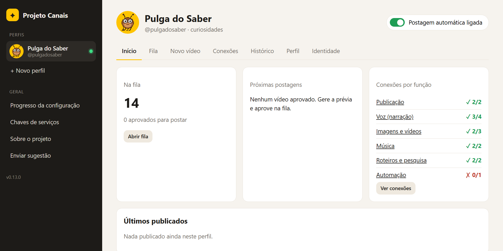

# Projeto Canais (canais-dark)

[](darkops/__init__.py)
[](LICENSE)
[](https://vincfreitas.github.io/projeto-canais/)
[](https://www.youtube.com/@pulgadosaber)
[](https://www.instagram.com/pulgadosaber)

> **Projeto Canais v0.20.0 (beta)** · criado por Vinicius Freitas · licença não comercial ([LICENSE](LICENSE))

Fábrica de canais "dark" (sem rosto) que **roda sozinha**: pesquisa temas que já dão certo, escreve roteiros com fatos checados, gera Shorts e Reels com narração, legendas, clipes reais, animações sincronizadas com a fala, efeitos sonoros e música livre, e **posta no YouTube e no Instagram nos horários marcados**, só o que você aprovou.

**Veja funcionando:** o canal de exemplo é o **Pulga do Saber**, curiosidades rápidas narradas por uma pulga em pixel art, no [YouTube](https://www.youtube.com/@pulgadosaber) e no [Instagram](https://www.instagram.com/pulgadosaber).

Tudo se controla pelo **Estúdio**, um painel no navegador com perfis (um por canal), conexões explicadas por função, fila com prévia e aprovação, editor e histórico.



**Neste README:** [Começar em 3 passos](#começar-em-3-passos-com-o-claude-code) · [Sem o Claude](#sem-o-claude-manual) · [Como funciona](#como-funciona) · [Conectores](#conectores) · [Estrutura](#estrutura) · [Regras](#regras-que-mantêm-o-canal-vivo) · [Testando?](#testando-sua-opinião-ajuda) · [Licença](#licença-e-autoria)

## Começar em 3 passos (com o Claude Code)

1. Instale o [Claude Code](https://claude.com/claude-code) e o [Python 3.11+](https://www.python.org/downloads/) (marque "Add to PATH").
2. Clone e abra a pasta no Claude Code:
   ```
   git clone https://github.com/VincFreitas/projeto-canais.git canais-dark
   cd canais-dark
   claude
   ```
3. Cole este prompt:
   > **Configure este projeto para mim do zero com a skill /configurar. Vá passo a passo, me explique cada conta que eu preciso criar e confira tudo com o diagnóstico no final.**

Antes de instalar, o Claude pergunta **quais plataformas você quer testar**: YouTube, Instagram (os dois com postagem automática), Facebook, TikTok ou Kwai (postagem manual), ou só gerar vídeos. Depois ele instala as dependências, abre o Estúdio e mostra só o tutorial das plataformas escolhidas (Azure, Pixabay, Google Cloud, Meta e n8n, conforme o caso). O progresso de cada plataforma aparece no Estúdio, em **Progresso da configuração**, e no terminal com `python -m darkops progresso`. Logins, senhas e aceites de termos ficam sempre com você. No fim, ele gera a **identidade visual das contas** (foto de perfil, capa do YouTube, marca d'água, bio e descrição) e, só depois da sua aprovação, aplica tudo no YouTube e no Instagram pelo navegador (skill `/identidade-visual`, ou aba **Identidade** do Estúdio para revisar e aprovar).

## Sem o Claude (manual)

```powershell
powershell -ExecutionPolicy Bypass -File instalar.ps1     # dependências, voz offline e .env
.\.venv\Scripts\python.exe -m darkops estudio            # abre o painel em http://127.0.0.1:8765
.\.venv\Scripts\python.exe -m darkops diagnostico        # o que falta configurar
.\.venv\Scripts\python.exe -m darkops progresso          # etapas feitas e próximas de cada plataforma
```
O passo a passo completo de cada conta está em [.claude/skills/configurar/SKILL.md](.claude/skills/configurar/SKILL.md).

## Como funciona

| Etapa | Onde |
|---|---|
| Achar temas que bombaram no nicho | Estúdio > Novo vídeo > **Descobrir assuntos fortes**, ou `/pesquisar-nicho <nicho>` (Claude Code) |
| Aprender o estilo de vídeos de referência | Estúdio > Perfil > **Aprender com referência** (mede cortes, palavras por minuto e duração; nunca copia o texto), ou `python -m darkops referencia <links>` |
| Definir o padrão do canal | Estúdio > Perfil > **Padrão dos vídeos**: motor da voz, imagens/vídeos e proporção, ritmo dos cortes, legenda (tamanho, fonte e cor) tema dos cards na tela (vidro escuro, arquivo frio, jornal antigo ou moderno limpo), nível de edição (simples, leve ou pro) e acervo da NASA |
| Dar personalidade ao canal | Estúdio > Perfil > **Personalidade do canal**: quem narra, tom, público, como os vídeos começam, linguagem e padrão de título e capa; o /escrever-roteiro e as levas seguem isso |
| Revisar antes de gerar | A tela do vídeo sem prévia mostra a **Revisão antes de gerar**: canal, visual, voz, cenas, duração, fontes, tempo para gerar e as notas do roteiro sobre o que ele escolheu |
| Escrever o roteiro com fontes, ganchos e animações | `/escrever-roteiro <ideia>`, banco de ganchos em [docs/ganchos.md](docs/ganchos.md) |
| Ver os números | Estúdio > **Estatísticas**: inscritos ou seguidores, visualizações, curtidas, comentários, compartilhamentos, salvamentos, minutos assistidos, duração média e retenção de cada vídeo, no YouTube e no Instagram (APIs oficiais, só leitura; `python -m darkops estatisticas`). Retenção e minutos do YouTube pedem a permissão extra "Liberar retenção" |
| Melhorar com base nos números | **Analisar com a IA**: o Claude lê as estatísticas e sugere mudanças com o motivo; cada uma tem Aprovar ou Recusar. Mudança de configuração só é aplicada se aprovada; orientação de conteúdo aprovada vira diretriz do canal, seguida pelos roteiros |
| Descrição e tags de cada vídeo | No Novo vídeo e na tela do vídeo: **a IA cria** (Claude, com as regras de alcance) ou **você escreve**; a publicação usa esse texto no YouTube e na legenda do Instagram (`python -m darkops descricao <roteiro>`) |
| Fazer o vídeo render mais | As regras da pesquisa em [docs/viralizacao.md](docs/viralizacao.md) viram checagens na revisão e no Conferir vídeo: gancho, título, chamada para comentar ou mandar, hashtags e 1ª linha da descrição |
| Escolher o tipo de cada vídeo | Estúdio > Novo vídeo, em todos os jeitos de criar: **curto** (Shorts/Reels 9:16) ou **longo** (YouTube 16:9), a duração e as plataformas de destino. Começa no padrão do perfil; a publicação só manda o vídeo para as plataformas marcadas, e vídeo longo nunca vai para o Reels |
| Começar de um roteiro ou de uma narração prontos | Estúdio > Novo vídeo > **Já tenho o roteiro ou a narração**: cola o texto (vira cenas pelo ritmo do canal) ou envia o áudio gravado (transcreve com o Azure e usa a sua voz, com legenda sincronizada) |
| Estilo das imagens | Estúdio > Perfil > Estilo visual: pixel art, desenho 2D, pintura histórica, foto antiga, anime, 3D, sombrio ou realista, todos desenhados no PC; ou clipes reais (Pexels/Pixabay) |
| Gerar imagens no Google Flow, Gemini ou ChatGPT | Prévia > **Imagens num gerador externo**: instruções, ficha do personagem e prompts em lotes de 20 para copiar; as imagens baixadas entram sozinhas nas cenas |
| Conferir antes de aprovar | Prévia > **Conferir vídeo** (ou `python -m darkops conferir <video>`): tela preta, silêncio, volume, duração e resolução |
| Gerar a prévia, ajustar e aprovar | Estúdio > Fila: **editor de cenas** (outra imagem, nova busca, arquivo do PC, movimento), legenda liga/desliga, baixar o vídeo |
| Criar vários vídeos de uma vez | Estúdio > Perfil > **Quantos vídeos criar de uma vez**: mostra o tempo estimado e o aviso de deixar o PC ligado; **Criar a leva agora** escreve cada roteiro com o Claude Code e gera a prévia (ou `python -m darkops leva --quantidade N`) |
| Reabastecer a fila sozinho | Marque **Criar outra leva quando sobrarem N vídeos**: depois de cada postagem o n8n roda `leva --se-faltar --fundo`, que cria uma leva nova quando a fila chega no mínimo (nada vai ao ar sem aprovação) |
| Postar às 12h e às 19h | n8n (workflow gerado por `python -m darkops n8n-workflow --importar`) |
| Títulos, agenda da semana, comentários | `/titulo-thumb`, `/planejar-semana`, `/responder-comentarios` |
| Medir e decidir | `/revisar-desempenho` |

## Conectores

| Função | Conectores | Custo |
|---|---|---|
| Publicação | YouTube Shorts (OAuth), Instagram Reels (token) · TikTok e Facebook em breve | Grátis |
| Voz | Azure Speech (principal), Edge, Piper offline, ElevenLabs | Grátis no F0 do Azure |
| Imagens e vídeos | Pixabay, Pexels, arquivos próprios (sem mídia de IA, desenho ou 3D) | Grátis |
| Música | Trilhas geradas pelo código, biblioteca própria com licença registrada | Grátis |
| Roteiros e pesquisa | Claude Code, yt-dlp | Conforme o seu plano |
| Automação | n8n local | Grátis |

## Estrutura

- `darkops/`: o código (CLI `python -m darkops`, com `--perfil <id>` em qualquer comando)
- `darkops/estudio/`: o painel (Flask, só em 127.0.0.1)
- `perfis/<id>/`: um canal por perfil (configuração, fila, publicados, controle; credenciais ficam fora do Git). Ao criar o perfil no Estúdio, escolha as plataformas (YouTube, Instagram, Facebook, TikTok, Kwai ou outra), o formato (Shorts/Reels vertical ou vídeo convencional 16:9), a duração de cada vídeo e um link de vídeo de exemplo. Só YouTube e Instagram postam sozinhos.
- `n8n/`: modelo do workflow e lançadores
- `site/`: página inicial, privacidade e termos exigidos pelo Google e pela Meta (GitHub Pages)
- `docs/img/`: imagens do README
- `docs/`: formato do roteiro e banco de ganchos

## Regras que mantêm o canal vivo

- Conteúdo com pesquisa e ângulo próprios: o YouTube desmonetiza produção em massa sem valor ("inautêntico").
- Fatos com fonte; lenda tratada como lenda; título e manchete entregues no vídeo.
- Só mídia e música com licença livre; mídia realista gerada por IA exige marcar "conteúdo sintético".
- Contas próprias (nada de contas compradas) e postagem só do que foi aprovado.
- Sem a auditoria do Google, o YouTube deixa os vídeos enviados pela API como privados.

## Testando? Sua opinião ajuda

No Estúdio, **Sobre o projeto** explica a ideia e tem o campo **Enviar sugestão**, que abre uma issue já preenchida aqui no GitHub. Enquanto a configuração não termina, o Estúdio fica em **modo guiado**: Fila, Novo vídeo e Histórico só liberam depois de concluir as etapas da tela Progresso (quem já tem tudo pronto pode desligar com `DARKOPS_MODO_GUIADO=0` no `.env`).

Se o projeto te ajudou, deixe uma ⭐ no repositório e siga o [Pulga do Saber no YouTube](https://www.youtube.com/@pulgadosaber) e no [Instagram](https://www.instagram.com/pulgadosaber).

## Licença e autoria

Criado por **Vinicius Freitas**. Distribuído sob a [PolyForm Noncommercial 1.0.0](LICENSE): pode baixar, testar, estudar e modificar para uso pessoal e não comercial, mantendo o crédito. Vender, revender ou usar comercialmente exige autorização do autor. A versão atual está em `darkops/__init__.py` (`python -m darkops --version`).
