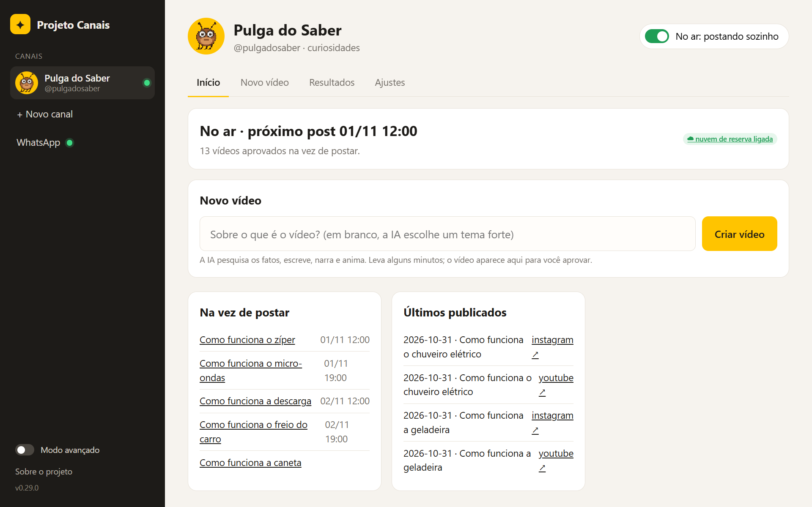
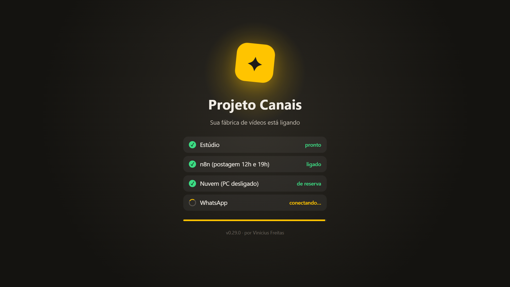
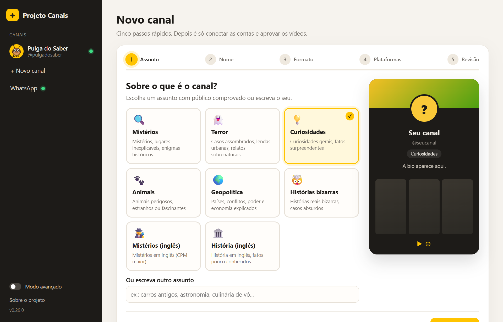
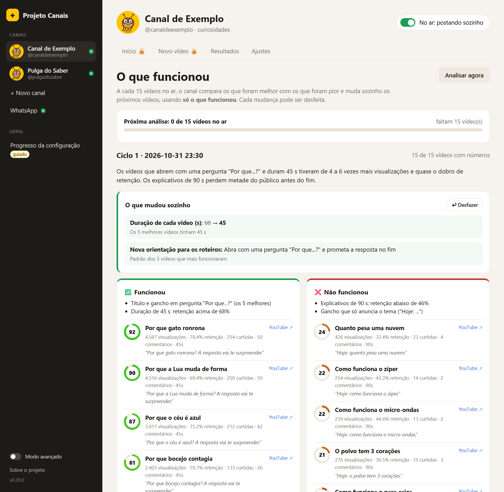
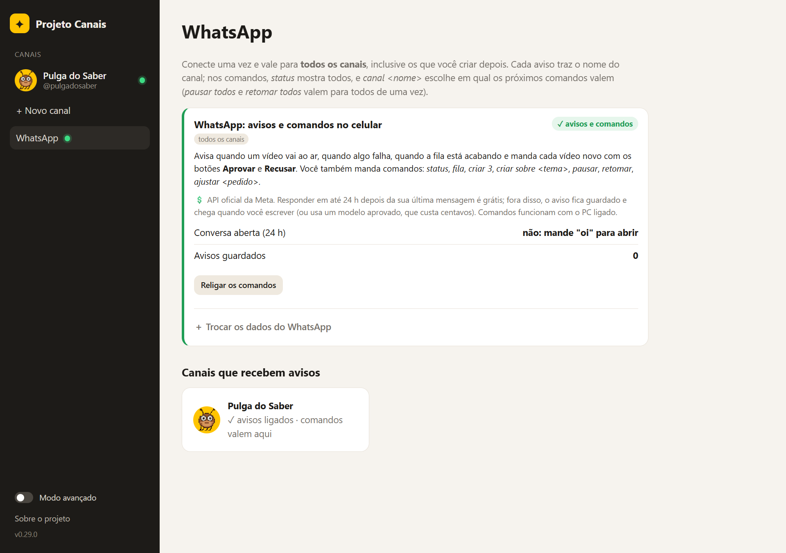

# Projeto Canais (canais-dark)

[](darkops/__init__.py)
[](LICENSE)
[](https://vincfreitas.github.io/projeto-canais/)
[](https://www.youtube.com/@pulgadosaber)
[](https://www.instagram.com/pulgadosaber)

> **Projeto Canais v0.48.1 (beta)** · criado por Vinicius Freitas · uso comercial liberado, inclusive monetização ([LICENSE](LICENSE))

Fábrica de canais "dark" (sem rosto) que **roda sozinha**: pesquisa temas que já dão certo, escreve roteiros com fatos checados, gera Shorts e Reels com narração, legendas, clipes reais, animações sincronizadas com a fala, efeitos sonoros e música livre, e **posta no YouTube e no Instagram nos horários marcados**, só o que você aprovou.

**Veja funcionando:** o canal de exemplo é o **Pulga do Saber**, curiosidades rápidas narradas por uma pulga em pixel art, no [YouTube](https://www.youtube.com/@pulgadosaber) e no [Instagram](https://www.instagram.com/pulgadosaber).

Tudo se controla pelo **Estúdio**, um painel no navegador com perfis (um por canal), conexões explicadas por função, fila com prévia e aprovação, editor e histórico. Ele **aprende sozinho**: a cada 15 vídeos no ar, descobre o que funcionou e ajusta os próximos. **Lê os comentários** e prepara respostas para você aprovar. Posta mesmo com o PC desligado, pela **nuvem** (GitHub Actions + n8n). Funciona em qualquer tela, do monitor ao celular.



**Neste README:** [Novidades](#novidades-v048) · [Começar em 3 passos](#começar-em-3-passos-com-qualquer-agente-de-ia) · [Sem agente](#sem-agente-manual) · [Como funciona](#como-funciona) · [Conectores](#conectores) · [Estrutura](#estrutura) · [Regras](#regras-que-mantêm-o-canal-vivo) · [Testando?](#testando-sua-opinião-ajuda) · [Licença](#licença-e-autoria)

## Novidades (v0.48)

**Comentários com resposta aprovada.** A cada 3 horas o canal lê os comentários do YouTube e do Instagram, separa perguntas, correções de fato, ideias de vídeo, elogios, críticas e spam, e escreve uma resposta curta no tom do canal. Você aprova, edita ou ignora em Resultados > **Comentários**. O que o público disse entra nas Estatísticas, na análise da IA e no aprendizado. Responder sozinho é opcional e só vale para elogios e perguntas simples.

**Voz escolhida ouvindo.** No Novo canal e em Ajustes, as 6 vozes recomendadas para o assunto do canal aparecem primeiro, cada uma com ▶ para ouvir. Também dá para ver mais vozes ou todas.

**Animações pelo HyperFrames.** Legenda que acende a palavra falada, título letra a letra, números que contam, carimbos e etiquetas, sincronizados com a narração.

**Estúdio em qualquer tela.** No celular, a lateral vira o botão **Menu**, as abas rolam para o lado e os campos ficam do tamanho do dedo. Abrir o Estúdio pelo celular ainda depende de um acesso seguro, planejado em [docs/app-e-site.md](docs/app-e-site.md).

### Anteriores

**Abertura animada.** O executável abre direto numa tela que confere o Estúdio, o n8n, a nuvem e o WhatsApp, e o logo "voa" para a lateral. Sem janelas de prompt piscando.



**Novo canal em 6 passos.** Assunto em cartões, nome com sugestões da IA, formato e voz, plataformas, contas e revisão, com uma prévia do canal mudando ao vivo. Ao criar, o canal já começa a produzir os **15 primeiros vídeos**.



**O que funcionou** (em Resultados). A cada 15 vídeos no ar há 2 dias, o canal ranqueia os vídeos (visualizações, retenção e engajamento), separa o que funcionou do que não funcionou e **muda sozinho os próximos vídeos usando só o que funcionou**, com **Desfazer**. *Print com dados de exemplo.*



**WhatsApp** (API oficial da Meta; desligado por enquanto, liga com `DARKOPS_WHATSAPP=1` no `.env`). Uma vez para todos os canais: avisa quando um vídeo vai ao ar, quando algo falha e quando a fila está acabando, manda cada vídeo novo com **Aprovar/Recusar** e obedece comandos como `status`, `criar 3` e `pausar todos`.



## Começar em 3 passos (com qualquer agente de IA)

1. Tenha um agente de IA, como o [Claude Code](https://claude.com/claude-code). Python, Node.js, n8n e o próprio Claude Code (que escreve os roteiros dentro do Estúdio) são instalados sozinhos, na pasta do projeto, com cada download conferido. Com você ficam só as **contas e chaves**: o login do Claude Code e as contas das plataformas.
2. Clone e abra a pasta no seu agente:
   ```
   git clone https://github.com/VincFreitas/projeto-canais.git canais-dark
   cd canais-dark
   ```
   Depois rode `claude`, `codex` ou `gemini` nessa pasta, ou abra a pasta no Cursor, no VS Code com o Copilot ou no Windsurf.
3. Cole o prompt do seu agente:
   - **Claude Code:**
     > **Configure este projeto para mim do zero com a skill /configurar. Vá passo a passo, me explique cada conta que eu preciso criar e confira tudo com o diagnóstico no final.**
   - **Qualquer outro agente** (Codex, Gemini CLI, Cursor, Copilot, Windsurf...):
     > **Leia o AGENTS.md e configure este projeto para mim do zero seguindo o docs/instalacao.md. Vá passo a passo, me explique cada conta que eu preciso criar e confira tudo com `python -m darkops diagnostico --json` no final.**

Os agentes leem as regras do projeto no [AGENTS.md](AGENTS.md), que é a fonte única (o `CLAUDE.md` e o `GEMINI.md` só importam esse arquivo). O passo a passo fica em [docs/instalacao.md](docs/instalacao.md).

Antes de instalar, o agente pergunta **quais plataformas você quer testar**: YouTube, Instagram (os dois com postagem automática), Facebook, TikTok ou Kwai (postagem manual), ou só gerar vídeos. Depois ele instala as dependências, abre o Estúdio e mostra só o tutorial das plataformas escolhidas (Azure, Pixabay, Google Cloud, Meta, GitHub e n8n, conforme o caso). O progresso de cada plataforma aparece no Estúdio, em **Progresso da configuração**, e no terminal com `python -m darkops progresso` (`--json` para agentes). Logins, senhas e aceites de termos ficam sempre com você. No fim, ele gera a **identidade visual das contas** (foto de perfil, capa do YouTube, marca d'água, bio e descrição). Só depois da sua aprovação, ele aplica tudo no YouTube e no Instagram, pelo navegador que o agente controla, ou você aplica à mão. Para revisar e aprovar, use a skill `/identidade-visual` ou o Estúdio, em Ajustes > **Foto, capa e bio das contas**.

## Sem agente (manual)

```powershell
powershell -ExecutionPolicy Bypass -File instalar.ps1     # tudo: Python se faltar, pacotes, voz, atalhos, Node.js, n8n e Claude Code
.\.venv\Scripts\python.exe -m darkops estudio            # abre o painel em http://127.0.0.1:8765
.\.venv\Scripts\python.exe -m darkops diagnostico        # o que falta configurar
.\.venv\Scripts\python.exe -m darkops progresso          # etapas feitas e próximas de cada plataforma
```
O passo a passo completo de cada conta está em [docs/instalacao.md](docs/instalacao.md).

## Como funciona

| Etapa | Onde |
|---|---|
| Pedir um vídeo | Estúdio > Início ou Novo vídeo: escreva o assunto (ou deixe em branco) e clique em **Criar vídeo**; a IA pesquisa, escreve, narra e anima, e o vídeo aparece no Início para aprovar |
| Dizer como quer o canal | Estúdio > Ajustes > **Como você quer o canal?**: escreva em texto livre; a IA mostra o que muda (antes e depois) e você aplica ou descarta |
| Ver todas as opções | Botão **Modo avançado** no rodapé da lateral, ou **Mostrar mais opções** em cada tela |
| Achar temas que bombaram no nicho | Estúdio > Novo vídeo > **Descobrir assuntos fortes**, ou `/pesquisar-nicho <nicho>` (Claude Code) |
| Aprender o estilo de vídeos de referência | Estúdio > Perfil > **Aprender com referência** (mede cortes, palavras por minuto e duração; nunca copia o texto), ou `python -m darkops referencia <links>` |
| Definir o padrão do canal | Estúdio > Perfil > **Padrão dos vídeos**: motor da voz, imagens/vídeos e proporção, ritmo dos cortes, legenda (tamanho, fonte e cor) tema dos cards na tela (vidro escuro, arquivo frio, jornal antigo ou moderno limpo), nível de edição (simples, leve ou pro) e acervo da NASA |
| Dar personalidade ao canal | Estúdio > Perfil > **Personalidade do canal**: quem narra, tom, público, como os vídeos começam, linguagem e padrão de título e capa; o /escrever-roteiro e as levas seguem isso |
| Revisar antes de gerar | A tela do vídeo sem prévia mostra a **Revisão antes de gerar**: canal, visual, voz, cenas, duração, fontes, tempo para gerar e as notas do roteiro sobre o que ele escolheu |
| Escrever o roteiro com fontes, ganchos e animações | `/escrever-roteiro <ideia>`, banco de ganchos em [docs/ganchos.md](docs/ganchos.md) |
| Abrir sem PowerShell | Atalho **Projeto Canais** na Área de Trabalho e/ou no Menu Iniciar (escolhido na instalação ou em Estúdio > **Configurações**); `python -m darkops abrir` faz o mesmo. Ao abrir, o Estúdio também liga o n8n escondido (leva de 1 a 3 min), e ele segue ligado para postar às 12h e às 19h. Abre numa **abertura animada** que confere o que já está de pé, sem janelas de prompt piscando |
| Manter o projeto atualizado | Estúdio > Configurações: atualização automática (busca no GitHub, espera as tarefas, fecha e abre sozinho e mostra a versão nova e o que mudou), **Procurar atualização** e **Atualizar dependências** (pacotes Python e yt-dlp, n8n, Claude Code). Pela CLI: `python -m darkops atualizar` e `python -m darkops atualizar-dependencias --aplicar` |
| Ver os números | Estúdio > **Estatísticas**: inscritos ou seguidores, visualizações, curtidas, comentários, compartilhamentos, salvamentos, minutos assistidos, duração média e retenção de cada vídeo, no YouTube e no Instagram (APIs oficiais, só leitura; `python -m darkops estatisticas`). Retenção e minutos do YouTube pedem a permissão extra "Liberar retenção" |
| Melhorar com base nos números | **Analisar com a IA**: o Claude lê as estatísticas e sugere mudanças com o motivo; cada uma tem Aprovar ou Recusar. Mudança de configuração só é aplicada se aprovada; orientação de conteúdo aprovada vira diretriz do canal, seguida pelos roteiros |
| Descrição e tags de cada vídeo | No Novo vídeo e na tela do vídeo: **a IA cria** (Claude, com as regras de alcance) ou **você escreve**; a publicação usa esse texto no YouTube e na legenda do Instagram (`python -m darkops descricao <roteiro>`) |
| Fazer o vídeo render mais | As regras da pesquisa em [docs/viralizacao.md](docs/viralizacao.md) viram checagens na revisão e no Conferir vídeo: gancho, título, chamada para comentar ou mandar, hashtags e 1ª linha da descrição |
| Escolher o tipo de cada vídeo | Estúdio > Novo vídeo, em todos os jeitos de criar: **curto** (Shorts/Reels 9:16) ou **longo** (YouTube 16:9), a duração e as plataformas de destino. Começa no padrão do perfil; a publicação só manda o vídeo para as plataformas marcadas, e vídeo longo nunca vai para o Reels |
| Começar de um roteiro ou de uma narração prontos | Estúdio > Novo vídeo > **Já tenho o roteiro ou a narração**: cola o texto (vira cenas pelo ritmo do canal) ou envia o áudio gravado (transcreve com o Azure e usa a sua voz, com legenda sincronizada) |
| Estilo das imagens | Estúdio > Perfil > Estilo visual: pixel art, desenho 2D, pintura histórica, foto antiga, anime, 3D, sombrio ou realista, todos desenhados no PC; ou clipes reais (Pexels/Pixabay) |
| Gerar imagens no Google Flow, Gemini ou ChatGPT | Prévia > **Imagens num gerador externo**: instruções, ficha do personagem e prompts em lotes de 20 para copiar; as imagens baixadas entram sozinhas nas cenas |
| Conferir antes de aprovar | Prévia > **Conferir vídeo** (ou `python -m darkops conferir <video>`): tela preta, silêncio, volume, duração e resolução |
| Gerar a prévia, ajustar e aprovar | Estúdio > Fila: **editor de cenas** (outra imagem, nova busca, arquivo do PC, movimento), legenda liga/desliga, baixar o vídeo |
| Criar vários vídeos de uma vez | Estúdio > Perfil > **Quantos vídeos criar de uma vez**: mostra o tempo estimado e o aviso de deixar o PC ligado; **Criar a leva agora** escreve cada roteiro com o Claude Code e gera a prévia (ou `python -m darkops leva --quantidade N`) |
| Reabastecer a fila sozinho | Marque **Criar outra leva quando sobrarem N vídeos**: depois de cada postagem o n8n roda `leva --se-faltar --fundo`, que cria uma leva nova quando a fila chega no mínimo (nada vai ao ar sem aprovação) |
| Postar às 12h e às 19h | n8n (workflow gerado por `python -m darkops n8n-workflow --importar`) |
| Postar com o PC desligado | Estúdio > Ajustes > Contas > **Nuvem**: um repositório privado de fila no seu GitHub roda o mesmo workflow do n8n no GitHub Actions às 12:20 e 19:20. Se o PC já postou no horário, a nuvem não faz nada; se não, ela posta o próximo aprovado. Os dois lados conferem o estado compartilhado (e a nuvem, a própria plataforma) e nunca postam duas vezes. Criar vídeos continua no PC (`python -m darkops nuvem-status`) |
| Criar as contas sem procurar nada | No Novo canal (passo **Contas**) e em Ajustes > **Criar as contas**: Gmail, canal do YouTube, Instagram, app do Google, app da Meta, GitHub e Microsoft na ordem, com nomes sugeridos a partir do nome do canal (um clique copia), o link oficial de cada passo e o que já está pronto. Os nomes dos repositórios do GitHub você escolhe ali |
| Escolher a língua e a região do público | Estúdio > Ajustes > **Público (língua e região)**, ou no 1º passo do Novo canal: português do Brasil ou de Portugal, inglês dos EUA ou do Reino Unido, espanhol do México, dos EUA ou da Espanha, francês, alemão e italiano. Roteiro, voz, descrição, tags e bio saem na língua de lá, com referências e unidades de lá; o YouTube recebe a língua certa; e os horários valem no fuso de lá (`python -m darkops mercados` lista todos) |
| Conectar contas sem copiar chave | Estúdio > Ajustes > Contas: **Entrar com a Microsoft** cria a chave grátis da voz (Azure F0), **Entrar com o GitHub** cria a fila da nuvem e a passagem do Instagram, **Entrar com Instagram** traz o token e o renova sozinho. Você só faz login; criar as contas continua com você |
| Acompanhar e mandar pelo WhatsApp (desligado por enquanto; liga com `DARKOPS_WHATSAPP=1` no `.env`) | Estúdio > barra lateral > **WhatsApp** (conecta uma vez e vale para todos os canais; API oficial da Meta, só o seu número): avisa quando um vídeo vai ao ar, quando algo falha e quando a fila está acabando, e manda cada vídeo novo com **Aprovar** e **Recusar**. Comandos: `status`, `fila`, `aprovar`, `criar 3`, `criar sobre <tema>`, `pausar`, `retomar`, `ajustar <pedido>`, `canal <nome>`. Os comandos chegam pelo n8n, com o PC ligado (`python -m darkops whatsapp testar`) |
| Aprender com o que funcionou | Todo canal começa com **15 vídeos**. A cada 15 vídeos no ar há 2 dias, o n8n (20h) busca os números, separa o que **funcionou** do que **não funcionou** e muda sozinho os próximos vídeos usando **só o que funcionou**. Estúdio > Resultados > **O que funcionou** mostra os dois grupos e as mudanças, com **Desfazer** (`python -m darkops aprender`, `aprender-desfazer`) |
| Instalar como aplicativo | No Chrome ou no Edge, com o Estúdio aberto: ícone **Instalar** na barra de endereço. Abre numa janela própria, com o ícone ✦. Os planos e as autorizações para virar aplicativo e site (cookies, LGPD, Google, Meta, lojas) ficam em [docs/app-e-site.md](docs/app-e-site.md) |
| Responder comentários | Estúdio > Resultados > **Comentários**: a cada 3 horas o n8n lê os comentários novos e a IA separa por tipo e rascunha a resposta; você aprova, edita ou ignora. No YouTube, clique uma vez em **Liberar comentários do YouTube**; no Instagram, conecte de novo se conectou antes da v0.46.0 (`python -m darkops comentarios --todos`) |
| Usar no celular ou no tablet | O Estúdio se ajusta a qualquer tela (menu recolhido, abas que rolam, campos maiores). O acesso pelo celular ainda não está liberado, por segurança: o plano está em [docs/app-e-site.md](docs/app-e-site.md) |
| Títulos, agenda da semana | `/titulo-thumb`, `/planejar-semana`, `/responder-comentarios` |
| Medir e decidir | `/revisar-desempenho` |

## Conectores

| Função | Conectores | Custo |
|---|---|---|
| Publicação e comentários | YouTube Shorts (OAuth), Instagram Reels (token) · TikTok e Facebook em breve | Grátis |
| Voz | Azure Speech (principal), Edge, Piper offline, Google Chirp 3 HD, Gemini TTS, ElevenLabs | Grátis no F0 do Azure; Chirp grátis até 1 milhão de caracteres por mês |
| Imagens e vídeos | Pixabay, Pexels, acervo da NASA (com crédito), arquivos próprios e cenas desenhadas no PC (pixel art, 2D, 3D e HyperFrames) | Grátis |
| Música e efeitos | Trilhas geradas pelo código, biblioteca própria com licença registrada, efeitos sonoros CC0 | Grátis |
| Roteiros e pesquisa | Claude Code, yt-dlp | Conforme o seu plano |
| Automação | n8n local | Grátis |

## Estrutura

- `darkops/`: o código (CLI `python -m darkops`, com `--perfil <id>` em qualquer comando)
- `darkops/estudio/`: o painel (Flask, só em 127.0.0.1)
- `perfis/<id>/`: um canal por perfil (configuração, fila, publicados, controle; credenciais ficam fora do Git). Ao criar o perfil no Estúdio, escolha as plataformas (YouTube, Instagram, Facebook, TikTok, Kwai ou outra), o formato (Shorts/Reels vertical ou vídeo convencional 16:9), a duração de cada vídeo e um link de vídeo de exemplo. Só YouTube e Instagram postam sozinhos.
- `darkops/aprendizado.py`: o ciclo "o que funcionou" a cada 15 vídeos; `darkops/comentarios.py`: coleta, triagem e respostas dos comentários; `darkops/whatsapp.py`: avisos e comandos (desligado por padrão); `darkops/nuvem.py`: postagem com o PC desligado
- `n8n/`: modelos dos workflows (postagem e análise do que funcionou; WhatsApp e resumo do dia) e lançadores
- `site/`: página inicial, privacidade (LGPD), termos e política de cookies com aviso de consentimento (GitHub Pages)
- `docs/img/`: imagens do README
- `docs/`: instalação para qualquer agente de IA, plano de aplicativo e site, formato do roteiro e banco de ganchos
- `AGENTS.md`: instruções do projeto para todos os agentes (o `CLAUDE.md` e o `GEMINI.md` importam este arquivo)

## Regras que mantêm o canal vivo

- Conteúdo com pesquisa e ângulo próprios: o YouTube desmonetiza produção em massa sem valor ("inautêntico").
- Fatos com fonte; lenda tratada como lenda; título e manchete entregues no vídeo.
- Só mídia e música com licença livre; mídia realista gerada por IA exige marcar "conteúdo sintético".
- Contas próprias (nada de contas compradas) e postagem só do que foi aprovado.
- Sem a auditoria do Google, o YouTube deixa os vídeos enviados pela API como privados.

## Testando? Sua opinião ajuda

No Estúdio, **Sobre o projeto** explica a ideia e tem o campo **Enviar sugestão**, que abre uma issue já preenchida aqui no GitHub. Enquanto a configuração não termina, o Estúdio fica em **modo guiado**: Fila, Novo vídeo e Histórico só liberam depois de concluir as etapas da tela Progresso (quem já tem tudo pronto pode desligar com `DARKOPS_MODO_GUIADO=0` no `.env`).

Se o projeto te ajudou, deixe uma ⭐ no repositório e siga o [Pulga do Saber no YouTube](https://www.youtube.com/@pulgadosaber) e no [Instagram](https://www.instagram.com/pulgadosaber).

## Segurança

O Estúdio só responde no próprio PC e se protege de DNS rebinding, CSRF e clickjacking; tokens nunca vão para log ou Git; o Claude Code chamado pelo projeto só grava nas pastas da fila e das cenas. Detalhes e o que fica com você: [docs/seguranca.md](docs/seguranca.md).

## Licença e autoria

Criado por **Vinicius Freitas**. Distribuído sob a [PolyForm Shield 1.0.0](LICENSE): pode baixar, usar, estudar e modificar para qualquer finalidade, inclusive produzir vídeos e monetizar os seus próprios canais, mantendo o crédito. Só não pode usar o projeto para oferecer um produto concorrente (vender ou revender o app, ou oferecê-lo como serviço pago); para isso, fale com o autor. A versão atual está em `darkops/__init__.py` (`python -m darkops --version`).
