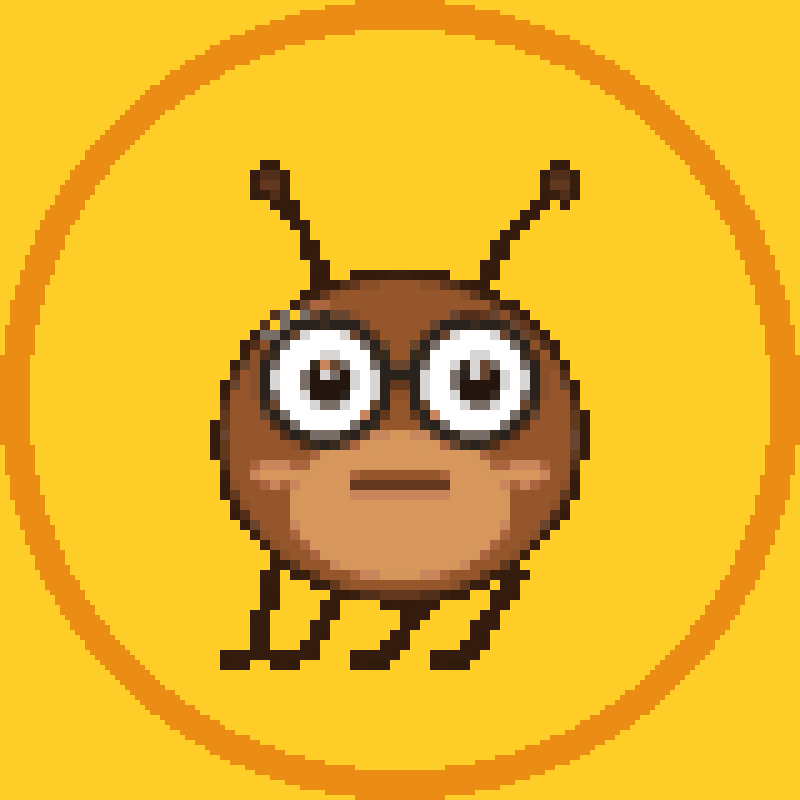
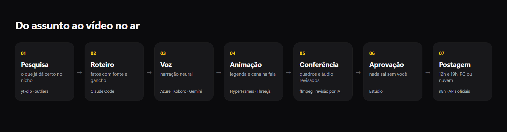
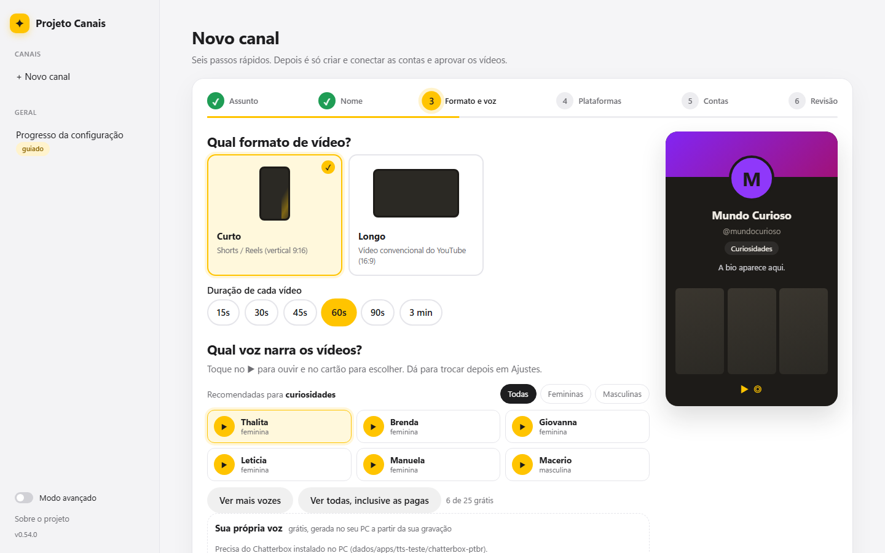
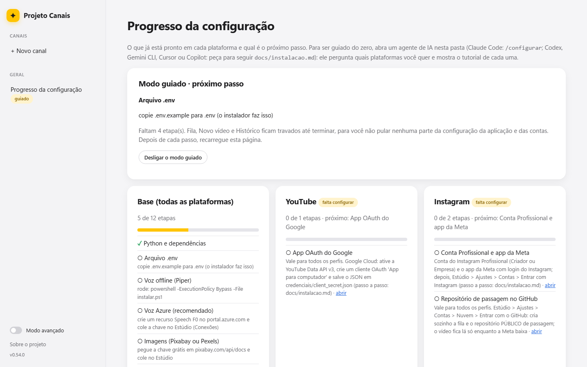
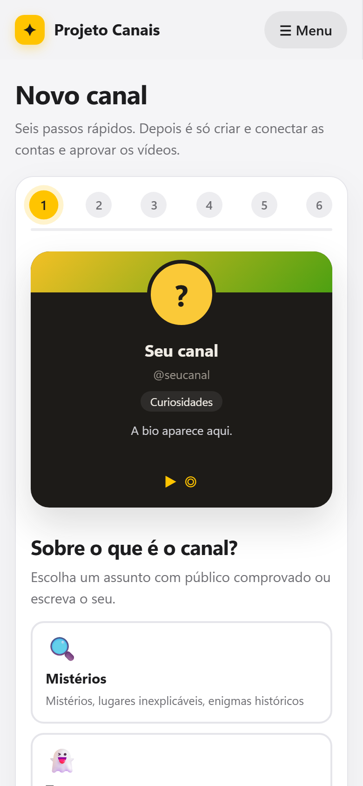
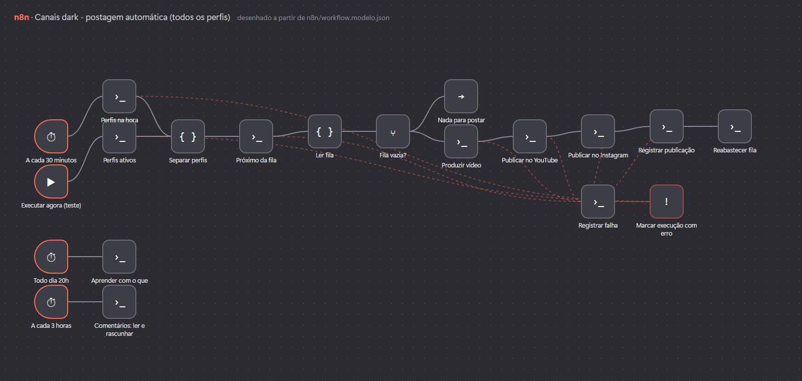
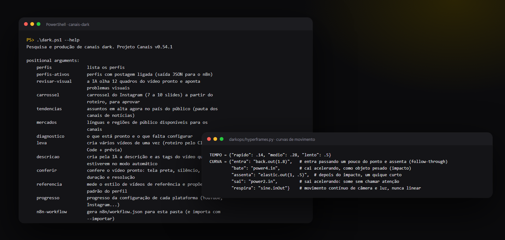

# Projeto Canais

[](darkops/__init__.py)
[](LICENSE)
[](#começar-em-3-passos)
[](#postagem-automática-com-o-n8n)
[](https://claude.com/claude-code)
[](AGENTS.md)
[](https://vincfreitas.github.io/projeto-canais/)

> **Projeto Canais v0.64.0 (beta)** · criado por Vinicius Freitas · uso comercial liberado, inclusive monetização ([LICENSE](LICENSE))

Fábrica de canais de vídeo sem rosto que **roda no seu próprio PC**. Pesquisa o que já dá certo num assunto, escreve roteiros com fatos checados, narra, anima cada cena junto com a fala, confere o vídeo pronto e **posta no YouTube e no Instagram nos horários marcados, só o que você aprovou**. Tudo se controla pelo **Estúdio**, um painel local no navegador, e a postagem roda pelo **n8n** no PC ou pelo **GitHub Actions** com o PC desligado.

**Neste README:** [Feito com o app](#feito-com-o-projeto-canais) · [Como funciona](#como-funciona) · [O Estúdio](#o-estúdio) · [Postagem com o n8n](#postagem-automática-com-o-n8n) · [Começar](#começar-em-3-passos) · [Comandos](#comandos) · [Conectores e custo](#conectores-e-custo) · [Perguntas frequentes](#perguntas-frequentes) · [Mapa do repositório](#mapa-do-repositório) · [Regras](#regras-que-mantêm-um-canal-vivo) · [Segurança](#segurança) · [Licença](#licença-e-autoria)

## Feito com o Projeto Canais



**Pulga do Saber** ([YouTube](https://www.youtube.com/@pulgadosaber) · [Instagram](https://www.instagram.com/pulgadosaber/)) é o canal de teste do próprio autor, feito de ponta a ponta com este app. São vídeos curtos de "como funciona" (geladeira, zíper, freio do carro, isqueiro...), com roteiro pesquisado e com fontes, narração, cenas em pixel art e postagem automática às 12h e às 19h. O autor só assiste à prévia e aprova.

<br clear="left">

| Números reais (13 de novembro de 2026, pelas APIs oficiais) | YouTube | Instagram |
|---|---|---|
| Vídeos publicados | 21 | 21 |
| Visualizações | 17.443 | 7.126 |
| Curtidas | 578 | 135 |
| Inscritos e seguidores | 47 | 7 |
| Vídeo mais visto | 1.366 visualizações | 1.274 visualizações |

O canal nasceu em 20 de outubro de 2026, então tinha três semanas nessa contagem. São números de um canal novo, sem anúncio pago e sem compra de seguidores, e mostram o app funcionando do jeito que ele foi feito para funcionar. Quanto custou cada vídeo está em [Perguntas frequentes](#perguntas-frequentes).

## Como funciona



| Etapa | O que acontece | Onde está |
|---|---|---|
| **Pesquisa** | Mapa de demanda pelo autocomplete do YouTube e os vídeos que passaram muito da mediana do próprio canal (outliers). Estuda o mecanismo, nunca o texto | `demanda`, `outliers`, `transcrever`, skill `/pesquisar-nicho` |
| **Roteiro** | O Claude Code escreve com gancho ([22 fórmulas](docs/ganchos.md)), ponto de vista, fonte em cada fato e as animações de cada cena. Uma checagem barra texto com cara de IA | `leva`, skill `/escrever-roteiro`, [formato do roteiro](docs/roteiro.md) |
| **Voz** | Azure Speech, Edge, Kokoro no PC (grátis, sem chave), Piper, Gemini, Chirp 3 HD, ElevenLabs ou a sua própria voz. A voz do canal se escolhe ouvindo amostras | `darkops/narracao.py`, `darkops/vozes.py` |
| **Animação** | Legenda que acende a palavra falada, título letra a letra, números que contam, etiquetas e cenas 3D em Three.js, tudo sincronizado pelo tempo de cada palavra ([princípios de movimento](docs/movimento.md)) | `darkops/hyperframes.py`, `darkops/palco_web.py` |
| **Conferência** | Tela preta, silêncio, volume, duração e resolução; depois a IA olha 12 quadros e aponta texto cortado ou cena que não combina com a fala | `conferir`, `revisar-visual` |
| **Aprovação** | Você assiste à prévia no Estúdio, troca uma cena se quiser e aprova. Nada vai ao ar sem isso | Estúdio > Início |
| **Postagem** | 12h e 19h no fuso do público do canal, pelas APIs oficiais. Depois, comentários lidos com resposta rascunhada e o ciclo "o que funcionou" ajustando os próximos vídeos | n8n, `darkops/nuvem.py`, `aprender` |

## O Estúdio

Painel local (Flask, só em `127.0.0.1:8765`) com um canal por perfil. Enxuto por padrão; o resto fica em **Mostrar mais opções** ou no **Modo avançado**.


**Novo canal em 6 passos.** Assunto, nome (com sugestões da IA), formato e voz, plataformas, contas e revisão, com uma prévia do canal mudando ao vivo. O passo Contas mostra o que criar, na ordem, com o link oficial de cada passo. Ao terminar, o canal já começa a produzir os 14 primeiros vídeos.



**Voz escolhida ouvindo.** As 6 vozes recomendadas para o assunto aparecem primeiro, cada uma com ▶; **Ver mais** e **Ver todas** abrem o resto. As amostras das vozes grátis vêm prontas no repositório; as pagas geram amostra na hora, com a sua chave.



**Modo guiado.** Enquanto a configuração não termina, a tela **Progresso** mostra o próximo passo de cada plataforma (`python -m darkops progresso` faz o mesmo no terminal).

| Tela | Para quê |
|---|---|
| **Início** | Vídeos prontos para aprovar e as próximas postagens |
| **Novo vídeo** | Um assunto em uma linha, ou **Sem ideia de tema?** para seguir a linha dos vídeos que mais funcionaram; curto (Shorts/Reels) ou longo (YouTube 16:9); ou uma **série de 2 ou 4 partes** ligadas, que saem sempre em ordem |
| **Resultados** | Números de cada vídeo pelas APIs oficiais, **O que funcionou** (a cada 14 vídeos, com Desfazer) e **Comentários** com resposta para aprovar |
| **Ajustes** | Público (língua e região), voz, padrão dos vídeos, personalidade, **Como você quer o canal?** em texto livre, contas, nuvem e Excluir canal |
| **Configurações** | Atualização automática pelo GitHub, atalhos e dependências |
| **Saúde do app** | Rotinas de integridade e segurança, atualizações de terceiros e ferramentas novas (modo avançado) |



**Qualquer tela.** De 320 px a monitor grande, sem rolagem lateral; no celular a lateral vira o botão **Menu**. O acesso pelo celular continua bloqueado até a revisão de segurança de [docs/app-e-site.md](docs/app-e-site.md).

**Aprende com o que funcionou.** A cada 14 vídeos no ar há 2 dias, o n8n ranqueia os vídeos (visualizações, retenção, engajamento e o tom dos comentários), separa o terço que funcionou e muda sozinho só o que veio dele, guardando o valor anterior para o **Desfazer**. Fora desse ciclo, toda sugestão espera a sua aprovação.

<br clear="right">

## Postagem automática com o n8n



O workflow sai de [`n8n/workflow.modelo.json`](n8n/workflow.modelo.json) (`python -m darkops n8n-workflow --importar`). Cada nó chama um comando da CLI, então tudo que o n8n faz também roda à mão.

- **A cada 30 minutos:** vê quais canais estão na hora de postar (no fuso do público de cada um), pega o próximo aprovado, publica e reabastece a fila quando ela fica curta.
- **Todo dia às 20h:** o ciclo "o que funcionou".
- **A cada 3 horas:** lê os comentários novos e rascunha respostas.
- **Com o PC desligado:** um repositório privado de fila no seu GitHub roda o mesmo fluxo no GitHub Actions às 12:20 e 19:20. Os dois lados conferem o estado compartilhado e nunca postam duas vezes.
- O Estúdio liga o n8n escondido ao abrir, sem janela de prompt piscando.

## Começar em 3 passos

1. Tenha um agente de IA, como o [Claude Code](https://claude.com/claude-code). Python, Node.js, n8n e o próprio Claude Code (que escreve os roteiros dentro do Estúdio) são instalados sozinhos, na pasta do projeto, com cada download conferido. Com você ficam só as **contas e chaves**.
2. Clone e abra a pasta no seu agente:
   ```
   git clone https://github.com/VincFreitas/projeto-canais.git canais-dark
   cd canais-dark
   ```
   Depois rode `claude`, `codex` ou `gemini` nessa pasta, ou abra a pasta no Cursor, no VS Code com o Copilot ou no Windsurf.
3. Cole o prompt do seu agente:
   - **Claude Code:**
     > **Configure este projeto para mim do zero com a skill /configurar. Vá passo a passo, me explique cada conta que eu preciso criar e confira tudo com o diagnóstico no final.**
   - **Qualquer outro agente** (Codex, Gemini CLI, Cursor, Copilot, Windsurf...):
     > **Leia o AGENTS.md e configure este projeto para mim do zero seguindo o docs/instalacao.md. Vá passo a passo, me explique cada conta que eu preciso criar e confira tudo com `python -m darkops diagnostico --json` no final.**

O agente pergunta primeiro **quais plataformas você quer testar** (YouTube e Instagram com postagem automática; Facebook, TikTok e Kwai com postagem manual; ou só gerar vídeos) e mostra só o tutorial delas. Logins, senhas e aceites de termos ficam sempre com você. O passo a passo completo está em [docs/instalacao.md](docs/instalacao.md), e as regras para os agentes no [AGENTS.md](AGENTS.md), a fonte única (o `CLAUDE.md` e o `GEMINI.md` só importam esse arquivo).

**Sem agente.** No Windows:

```powershell
powershell -ExecutionPolicy Bypass -File instalar.ps1     # Python se faltar, pacotes, voz, atalhos, Node.js, n8n e Claude Code
.\dark.ps1 estudio                                       # abre o painel em http://127.0.0.1:8765
.\dark.ps1 diagnostico                                   # o que falta configurar
```

No macOS e no Linux (precisa de Python 3.11 ou mais novo, curl e git):

```bash
./instalar.sh          # pacotes, voz, Node.js, n8n, Claude Code e Chromium, tudo dentro da pasta
./dark.sh estudio      # abre o painel em http://127.0.0.1:8765
./dark.sh diagnostico  # o que falta configurar
```

O Estúdio abre em qualquer navegador (Chrome, Edge, Firefox, Safari), e os testes automáticos conferem as telas em Chromium, Firefox e WebKit.

**Com qualquer IA, pelo MCP.** `python -m darkops mcp-configurar` liga o servidor MCP do Projeto Canais no Claude Code, Codex, Gemini CLI, Cursor e VS Code/Copilot. Para o Claude Desktop, o Windsurf e outros clientes, `mcp-configurar --mostrar` dá o bloco para colar. A IA consulta diagnóstico, canais, fila e saúde do app, escreve levas e gera prévias. Publicar, aprovar e responder comentários continuam com você, no Estúdio.

**Como plugin do Claude Code:** `/plugin marketplace add VincFreitas/projeto-canais` e depois `/plugin install projeto-canais@projeto-canais` trazem as skills.

## Comandos



Na raiz do projeto: `.\dark.ps1 <comando>` no Windows, `./dark.sh <comando>` no macOS e no Linux, ou `python -m darkops <comando>` com o Python do `.venv`. Qualquer comando aceita `--perfil <id>`.

| Comando | O que faz |
|---|---|
| `estudio` / `abrir` | Abre o Estúdio (o atalho da Área de Trabalho roda o `abrir`) |
| `diagnostico` / `progresso` | O que está pronto e o que falta, por plataforma (`--json` para agentes) |
| `demanda` / `outliers` / `transcrever` | Pesquisa de oferta e demanda de um nicho |
| `leva --quantidade N` | Escreve N roteiros com o Claude Code e gera as prévias (`--tema`, `--se-faltar`, `--fundo`) |
| `produzir <roteiro.json>` | Vídeo, thumbnail e metadados a partir do roteiro |
| `conferir <video>` / `revisar-visual` | Conferência técnica e revisão visual pela IA |
| `referencia <links>` | Mede o estilo de vídeos de referência (cortes, palavras por minuto, duração) |
| `vozes-amostras` / `comparar-vozes` / `instalar-voz-local` | Amostras para escolher a voz e as vozes grátis no PC |
| `descricao` / `carrossel` | Descrição e tags pela IA; carrossel do Instagram para aprovar |
| `estatisticas` / `analisar` / `aprender` | Números pelas APIs oficiais, análise da IA e o ciclo "o que funcionou" |
| `comentarios --todos` | Lê, classifica e rascunha respostas |
| `n8n-workflow --importar` / `nuvem-status` | Postagem pelo PC e pela nuvem |
| `atualizar` / `atualizar-dependencias` | Versão nova do GitHub; versões novas de tudo que é de terceiros (Python, n8n, Node, HyperFrames, Claude Code...) |
| `integridade` / `rotinas` / `ferramentas-buscar` | Integridade e segurança, rotinas automáticas e ferramentas novas que podem melhorar o app |
| `cofre-proteger` | Cifra no disco os tokens dos canais, o app do Google e as chaves do `.env` |
| `mcp` / `mcp-configurar` | Servidor MCP para qualquer IA comandar o app |

Skills do Claude Code (em `.claude/skills/`; outro agente lê o `SKILL.md` e segue): `/configurar`, `/conectar-contas`, `/pesquisar-nicho`, `/escrever-roteiro`, `/desenhar-prancha`, `/produzir-video`, `/titulo-thumb`, `/serie`, `/ajustar-canal`, `/estudar-referencia`, `/planejar-semana`, `/responder-comentarios`, `/revisar-desempenho`, `/identidade-visual`, `/verificar-app`, `/atualizar-app` e `/buscar-ferramentas`.

## Conectores e custo

| Função | Conectores | Custo |
|---|---|---|
| Publicação e comentários | YouTube Data API (OAuth), Instagram Graph API · TikTok e Facebook em breve | Grátis |
| Voz | Azure Speech, Edge, Kokoro e Piper no PC, Google Chirp 3 HD, Gemini TTS, ElevenLabs, Chatterbox com a sua voz | Grátis no Kokoro, no Piper e no F0 do Azure |
| Imagens e vídeos | Pixabay, Pexels, acervo da NASA (com crédito), arquivos próprios e cenas desenhadas no PC (pixel art, 2D, 3D e HyperFrames) | Grátis |
| Música e efeitos | Trilhas geradas pelo código, biblioteca com licença registrada, efeitos sonoros CC0 | Grátis |
| Roteiros e pesquisa | Claude Code, yt-dlp, faster-whisper | Conforme o seu plano do Claude |
| Automação | n8n local, GitHub Actions num repositório privado | Grátis |

## Perguntas frequentes

**Quanto custa um vídeo?** O app é grátis, e voz, imagens, música, n8n e postagem também podem sair de graça (tabela acima). O que tem custo é a IA que pesquisa e escreve, o Claude Code. Medido em 19 roteiros reais do projeto (novembro de 2026), no preço da API do Claude:

| O que a IA faz em cada vídeo | Modelo | Custo médio |
|---|---|---|
| Pesquisa os fatos e escreve o roteiro | Opus 5.5 | US$ 1,96 |
| Descrição, tags e hashtags | Haiku 4.5 | US$ 0,10 |
| Revisão visual da prévia | Sonnet 5 | US$ 0,16 |
| Carrossel do Instagram | Sonnet 5 | US$ 0,11 |
| **Total por vídeo curto** | | **US$ 2,33** |
| Animação escrita pela IA (Prancha de Campo, opcional) | Opus 5.5 | + US$ 3,25 |

Com um plano do Claude (Pro ou Max), não há cobrança por vídeo: cada vídeo usa uma parte do limite do plano, e quando o limite acaba a leva continua sozinha depois. Montar o vídeo no PC leva de 5 a 25 minutos, conforme o estilo e a placa de vídeo. O Estúdio anota o custo de cada chamada da IA em `dados/custos.jsonl` e mostra a média do seu PC em **Sobre o projeto**.

**Funciona de verdade?** Funciona: veja o canal [Pulga do Saber](#feito-com-o-projeto-canais), feito inteiro com o app, com os números reais.

**Precisa de um PC bom?** Não. Com placa de vídeo a montagem é mais rápida; sem ela, o app mede o PC e ajusta a qualidade do 3D sozinho.

**Posso monetizar os meus canais?** Pode. A licença só não permite vender ou revender o app, nem oferecê-lo como serviço pago (veja [Licença e autoria](#licença-e-autoria)).

**Tenho uma dúvida ou uma ideia.** Abra uma [issue](https://github.com/VincFreitas/projeto-canais/issues) ou use **Enviar sugestão** no Estúdio. As dúvidas que chegam com frequência viram respostas aqui.

## Mapa do repositório

| Pasta | O que tem |
|---|---|
| `darkops/` | O código: CLI (`__main__.py`), pesquisa, narração, render, publicação, nuvem, aprendizado e comentários |
| `darkops/estudio/` | O Estúdio (Flask, templates e `static/estudio.css`) |
| `n8n/` | Modelos dos workflows e o lançador escondido (`n8n.ps1`) |
| `.claude/skills/` | As skills do fluxo (pesquisar, escrever, produzir, revisar...) |
| `docs/` | [Instalação](docs/instalacao.md), [roteiro](docs/roteiro.md), [ganchos](docs/ganchos.md), [movimento](docs/movimento.md), [viralização](docs/viralizacao.md), [monetização](docs/monetizacao.md), [segurança](docs/seguranca.md) e [app e site](docs/app-e-site.md) |
| `assets/` | Amostras de voz, músicas e efeitos com licença registrada |
| `cenas/comum3d.js` | Kit comum das cenas 3D (sala, materiais, câmera e etiquetas) |
| `roteiros/exemplo-*.json` | Roteiros de exemplo (vertical e longo) |
| `docs/capa/` | A animação da capa (HTML + GSAP) e o `render.py` que gera o `docs/img/capa.gif` |
| `site/` | Página do projeto, privacidade (LGPD), termos e cookies (GitHub Pages) |
| `perfis/`, `cenas/`, `roteiros/`, `saida/`, `obra/`, `dados/` | Seus canais, cenas, roteiros, vídeos, intermediários e programas instalados. Ficam só no seu PC, fora do Git |

## Regras que mantêm um canal vivo

- Conteúdo com pesquisa e ângulo próprios: o YouTube desmonetiza produção em massa sem valor ("inautêntico").
- Fatos com fonte; lenda tratada como lenda; título e capa entregues no vídeo.
- Só mídia e música com licença livre; mídia realista gerada por IA exige marcar "conteúdo sintético".
- Identidade própria para cada canal, tirada do tema que você escolheu; nada copiado de outro canal.
- Contas próprias (nada de contas compradas) e postagem só do que foi aprovado.
- Sem a auditoria do Google, o YouTube deixa os vídeos enviados pela API como privados.

## Segurança

O Estúdio só responde no próprio PC e se protege de DNS rebinding, CSRF e clickjacking. Tokens e chaves ficam cifrados no disco com uma chave do seu usuário (DPAPI no Windows, chaveiro no macOS e no Linux) e nunca vão para log ou Git. O Claude Code chamado pelo projeto não lê o `.env` nem os tokens, só tem as ferramentas de cada tarefa e só grava nas pastas da fila e das cenas. A tela **Saúde do app** confere sozinha, todo dia, a integridade dos arquivos e dos programas instalados, os segredos e as falhas conhecidas nos pacotes; toda semana, as versões novas de terceiros e ferramentas abertas que podem melhorar o app (só avisa: nada é instalado sem o seu clique). Detalhes e o que fica com você: [docs/seguranca.md](docs/seguranca.md).

## Status e limites

Versão de teste (beta), feita no Windows 11 e testada também no macOS e no Linux pelos testes automáticos do GitHub (`.github/workflows/testes.yml`). A postagem automática funciona no YouTube e no Instagram; Facebook, TikTok e Kwai ainda são manuais. O acesso pelo celular e o modo servidor estão bloqueados até a revisão de segurança. No Estúdio, **Sobre o projeto** tem o campo **Enviar sugestão**, que abre uma issue já preenchida aqui no GitHub. Se o projeto te ajudou, deixe uma ⭐.

## Licença e autoria

Criado por **Vinicius Freitas**. Distribuído sob a [PolyForm Shield 1.0.0](LICENSE): pode baixar, usar, estudar e modificar para qualquer finalidade, inclusive produzir vídeos e monetizar os seus próprios canais, mantendo o crédito. Só não pode usar o projeto para oferecer um produto concorrente (vender ou revender o app, ou oferecê-lo como serviço pago); para isso, fale com o autor. A versão atual está em `darkops/__init__.py` (`python -m darkops --version`).

<!-- Você leu o README até o fim? Obrigado! Na linha de comando, experimente: python -m darkops estrela -->

<!-- SPDX-License-Identifier: LicenseRef-PolyForm-Shield-1.0.0 -->
<!-- Projeto Canais · Vinicius Freitas · github.com/VincFreitas/projeto-canais -->
