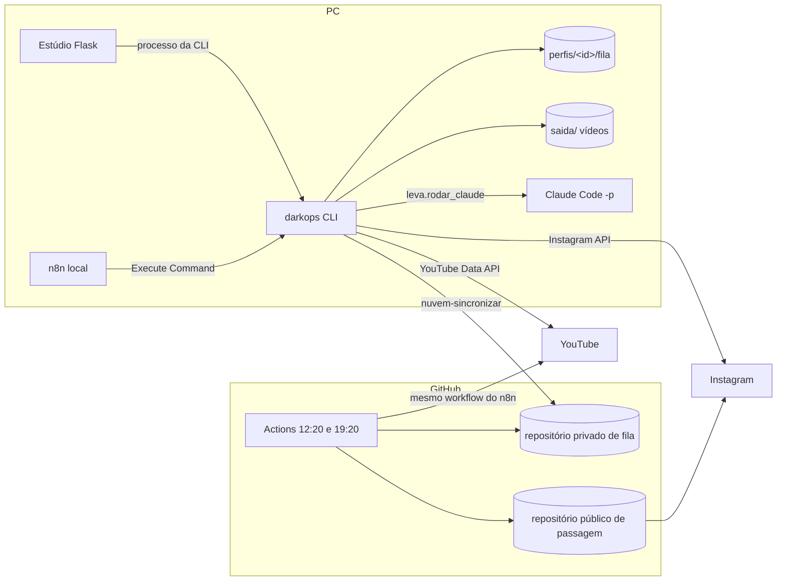

# Arquitetura do Projeto Canais

Como as peças do app se encaixam: da ideia ao vídeo publicado, no PC e na nuvem. As regras de trabalho dos agentes de IA ficam no [AGENTS.md](../AGENTS.md); o guia de quem mexe no código está em [desenvolvimento.md](desenvolvimento.md) e a lista de comandos em [cli.md](cli.md).

## Visão geral

O app é um pacote Python (`darkops/`) com três portas de entrada que chamam o mesmo código:

| Porta | O que é | Quem usa |
|---|---|---|
| CLI (`python -m darkops <comando>`, `dark.ps1`, `dark.sh`) | `darkops/__main__.py`: um subcomando por tarefa, saída em texto ou JSON | você, o n8n, o GitHub Actions, as skills |
| Estúdio (`python -m darkops estudio`) | `darkops/estudio/`: painel Flask em `http://127.0.0.1:8765` | você, no navegador |
| Servidor MCP (`python -m darkops mcp`) | `darkops/mcp_servidor.py`: JSON-RPC pela entrada padrão | qualquer IA com MCP (só lê e prepara) |

O Estúdio não publica nem produz dentro do próprio processo: cada tarefa pesada roda como um processo da CLI (`_iniciar_job`), o mesmo comando que o n8n usa. Assim, o que funciona no Estúdio funciona na automação, e uma falha numa tarefa não derruba o painel.

## Módulos

### Entrada e orquestração
| Módulo | Papel |
|---|---|
| `__main__.py` | Todos os subcomandos da CLI (`cmd_*`) e o `argparse` em `main()` |
| `config.py` | Caminhos (`RAIZ`, `SAIDA`, `OBRA`), variáveis do `.env` (abertas pelo cofre) e presets de nicho |
| `perfis.py` | Um canal por pasta em `perfis/<id>/` (`Perfil`: `perfil.json`, `fila/`, `publicados/`, `controle/`, `credenciais/`) |
| `fila.py` | Fila de postagem: ordem por nome, só sai o aprovado, série na ordem, `estado.json` contra post duplicado, `testes.csv`, `falhas.log` |
| `leva.py` | Levas de vídeos: pede os roteiros ao Claude Code (`rodar_claude`), gera as prévias, reabastece a fila e espera o limite do plano |
| `serie.py` | Séries de 2 ou 4 partes: plano, ordem garantida na fila e na nuvem |
| `aprovacao.py` | Aprovação automática pelas conferências (ou espera o dono, com o motivo) |
| `rotinas.py` | Agenda das rotinas (integridade, atualizações, ferramentas novas, vitrine) |

### Roteiro e conteúdo
| Módulo | Papel |
|---|---|
| `pesquisa.py`, `tendencias.py`, `referencia.py` | Demanda e outliers (yt-dlp), assuntos em alta (RSS do Google), estilo de vídeos de referência |
| `auditoria.py` | Gancho, estrutura, tamanho da fala e texto com cara de IA (`CARA_DE_IA`) |
| `descricao.py`, `palavra.py`, `carrossel.py` | Descrição e tags, chamada final e resposta à palavra-chave, carrossel do Instagram |
| `canal_ia.py`, `analise.py`, `aprendizado.py` | Ajuste do canal por pedido, análise das estatísticas e o ciclo automático "o que funcionou" |
| `comentarios.py` | Coleta, triagem pela IA e rascunho de resposta (publicar exige aprovação, salvo o modo simples) |
| `cortes.py` | Cortes de live: picos, transcrição, escolha pela IA, montagem vertical, vigia dos streamers autorizados |

### Produção do vídeo
| Módulo | Papel |
|---|---|
| `producao.py` | Roteiro JSON para vídeo pronto: narra, monta as cenas, junta, confere caminhos (`caminhos_inseguros`) |
| `narracao.py`, `vozes.py`, `voz_local.py`, `chatterbox_ponte.py` | Motores de voz, legendas sincronizadas por palavra, catálogo e amostras |
| `visuais.py`, `palco.py`, `palco_web.py`, `cinema.py`, `cenas_codigo.py`, `dossie.py`, `animacoes.py` | Imagem de cada cena: banco de mídia, pixel art, 3D no Chromium, cenas desenhadas em código e infográficos |
| `hyperframes.py`, `prancha.py`, `fonte_pixel.py` | Camada HTML/GSAP renderizada em MP4 e o motor Prancha de Campo |
| `render.py`, `musica.py`, `efeitos.py`, `sincronia.py` | ffmpeg (cena por cena, com cache em `obra/`), trilha, efeitos sonoros e mixagem |
| `conferir.py`, `revisao_visual.py` | Conferência técnica do vídeo (tela preta, silêncio, volume, capa) e revisão visual pela IA |
| `aparencia.py`, `identidade.py`, `identidade_prancha.py` | Aparência própria de cada canal e identidade das contas |

### Publicação e contas
| Módulo | Papel |
|---|---|
| `publicar.py` | Upload no YouTube (Data API v3, OAuth com token no cofre) |
| `instagram.py` | Reels pela Instagram API com login do Instagram (renova o token aos 40 dias) |
| `nuvem.py` | Reserva da postagem no GitHub Actions: sincronia, horários (`slot_atual`, `reservar_slot`), segredos e passagem pública dos vídeos |
| `contas.py`, `contas_guia.py`, `atualizar_contas.py`, `excluir.py` | Login no GitHub e no Azure, guia de criação das contas, textos do canal levados às contas, exclusão de canal |
| `estatisticas.py`, `monetizacao.py` | Números pelas APIs oficiais (só leitura) e situação da monetização |
| `whatsapp.py` | Avisos e comandos pelo WhatsApp (desligado por decisão do dono; o código fica) |

### Base, segurança e manutenção
| Módulo | Papel |
|---|---|
| `sistema.py`, `fontes.py`, `janelas.py` | O que muda entre Windows, macOS e Linux, num lugar só |
| `cofre.py` | Segredos cifrados no disco (veja [Cofre](#cofre)) |
| `seguranca.py` | `ocultar()` (esconde token em toda mensagem) e `link_publico()` (link colado só da internet) |
| `ambiente.py` | Modo do Estúdio (local; servidor preparado e bloqueado), cookies e origens aceitas |
| `integridade.py`, `terceiros.py`, `ferramentas.py` | Integridade e segurança, atualizações autônomas com conferência e volta, ferramentas novas |
| `app.py`, `apps.py`, `instalacao.py`, `n8n_lancador.py` | Atalhos, atualização do app, programas em `dados/apps/`, workflow do n8n e o lançador fora do Windows |
| `autoria.py`, `vitrine.py`, `repositorio.py`, `custos.py` | Créditos e versão, números do canal de teste no README, manutenção do repositório e custo da IA por vídeo |

## Da leva à postagem

1. **Leva** (`leva --quantidade N`, botão Novo vídeo, ou o n8n com `leva --se-faltar --fundo` quando a fila fica curta). Para cada vídeo, `leva.rodar_claude` chama o Claude Code com a skill `/escrever-roteiro`. Ele pesquisa os fatos (WebSearch, WebFetch), grava `perfis/<id>/fila/<nnn>-<slug>.json` e, quando o canal usa, a cena 3D (`cenas/*.3d.js`) ou a prancha (`cenas/*.prancha.json`, numa chamada própria). Antes de terminar, roda `palco-testar` e `roteiro-auditar` até sair sem erro. A leva só roda com o canal configurado (`leva.falta_configurar`); sem isso, ou com o limite do Claude, o pedido fica em `controle/leva-adiada.json` e o Estúdio retoma sozinho.
2. **Prévia** (`producao.produzir`): narração, cenas, camada do HyperFrames, mixagem em `render.juntar`, thumbnail e metadados em `saida/`.
3. **Conferências**: `conferir` (técnica), `revisao_visual` (a IA olha 12 quadros) e `auditoria` (texto). Com `aprovacao_automatica` ligada, `aprovacao.py` marca `"aprovado": true` só se tudo passar; o que não passa espera o dono com o motivo.
4. **Postagem pelo n8n** (`n8n/workflow.modelo.json`, a cada 30 minutos): `perfis-ativos --na-hora` lista os canais com horário pendente; para cada um, `fila-proximo` devolve o próximo aprovado e reserva o horário; `fila-produzir` produz o vídeo (as cenas da prévia saem do cache em `obra/`); `publicar-youtube` e `publicar-instagram` publicam; `fila-concluir` move para `publicados/` e anota o `testes.csv`. Qualquer erro vai para `registrar-falha` (`controle/falhas.log`, passado por `ocultar`). Às 20h roda `aprender`, a cada 3 horas `comentarios --todos` e às 3h `rotinas --vencidas`.
5. **Depois do ar**: `estatisticas`, `comentarios`, `aprender` (a cada 14 vídeos) e o ciclo recomeça.

Todo nó que roda por canal no n8n precisa de `"executeOnce": false` (o n8n 2.x liga "Execute Once" por padrão e só o primeiro canal postava); `tests/test_alcance.py` confere.

## PC e nuvem

- **PC**: o n8n local posta às 12:00 e 19:00 no fuso do mercado do canal (`mercados.fuso`, nunca o do Windows). Ligado depois do horário, posta o que perdeu (janela de 6 horas, `nuvem.JANELA_SLOT_H`).
- **Nuvem** (opcional, `nuvem.py`): um repositório **privado** de fila no GitHub roda o mesmo workflow no Actions às 12:20 e 19:20, sem produzir vídeo. O PC manda os vídeos aprovados (`nuvem-sincronizar`) e os tokens como Secrets cifrados. No Actions, `nuvem-preparar` monta a fila e as credenciais, o n8n executa e `nuvem-devolver` grava o estado de volta.
- **Sem post duplicado**: `controle/slots.json` (quem atendeu cada horário) e `estado.json` (IDs por vídeo e plataforma) vão e voltam com a nuvem. `nuvem.reservar_slot` impede duas rodadas do n8n no mesmo horário, e `fila.ja_publicado` impede repetir um upload num retry.
- **Instagram**: a API exige `video_url` público, então o vídeo passa pelo repositório **público** de passagem (`NUVEM_VIDEOS_REPO`) só enquanto a Meta baixa.

## n8n

- Instalado em `dados/apps/n8n` (versão principal 2), aberto escondido pelo Estúdio (`app.ligar_n8n`, `n8n/n8n.ps1 -NoOpen` no Windows, `n8n_lancador.py` fora dele), preso a `127.0.0.1`.
- O workflow é gerado do modelo para esta pasta (`n8n-workflow --importar`, que preenche `__PASTA__` e `__PYTHON__` e tira o `cd /d` fora do Windows) e só vale depois de reiniciar o n8n (`app.reiniciar_n8n`, que recusa perto dos horários de postagem).
- O que entra num comando do n8n não pode ter `$`, crase, aspas, `%`, `!`, `&`, `|`, `;`, `<`, `>`, `^` nem quebra de linha: `fila.seguro_para_comando` recusa o arquivo e o nó Registrar falha limpa a mensagem.

## Estúdio

- `darkops/estudio/__init__.py`: rotas, travas e tarefas. `tarefas.py` (tela de tarefa: estimativa e frase de resultado), `lobby.py` (tela inicial), `conectores.py` (catálogo de conexões), `templates/` (Jinja, com escape automático) e `static/` (`estudio.css`, `tema.js`, service worker).
- Travas em toda requisição (`_so_local`): só `127.0.0.1`/`::1`, Host local (contra DNS rebinding) e Origin/Referer do próprio Estúdio em todo POST (`ambiente.origem_permitida`, com a porta). Cabeçalhos em `_cabecalhos`: CSP com nonce por página (`csp_nonce()`, sem `'unsafe-inline'` para script), `X-Frame-Options`, `nosniff`, `Referrer-Policy`, `Cross-Origin-Resource-Policy`, `Cross-Origin-Opener-Policy` e `Permissions-Policy`.
- Links de volta passam por `volta_segura` e todo link que vem de dado passa pelo filtro `|link` (só http(s) ou caminho do próprio Estúdio).
- Nada de JavaScript dentro do HTML: os templates usam `data-*` (`data-pergunta`, `data-ao-clicar`, `data-mostra`...) e `static/estudio.js` liga os eventos; as funções de cada tela ficam no `<script nonce="{{ csp_nonce() }}">` dela.
- Laços em segundo plano (iniciados em `rodar`): atualização do app, levas adiadas, palavra-chave nos comentários, rotinas, vigia dos cortes e aprovação automática.
- Modo enxuto por padrão; o resto aparece em "Mostrar mais opções" ou no modo avançado. Modo guiado trava as telas de produção até a configuração terminar.

## Cofre

- `cofre.py` cifra (SecretBox do PyNaCl) os tokens dos canais, tudo em `credenciais/` e, no `.env`, os valores de nomes com KEY, TOKEN, SECRET, SENHA, PASSWORD ou VERIFICAR (`cofre:<base64>`).
- A chave é do usuário do sistema: DPAPI no Windows (`dados/cofre.chave`), chaveiro no macOS e no Linux (ou um arquivo só do dono fora do projeto). Duas partidas criando a chave ao mesmo tempo usam a mesma (`_gravar_privado(..., so_se_novo=True)`).
- Leia e grave segredo só por `cofre.ler`, `cofre.gravar` e `cofre.reescrever_env`; o `config` já abre o `.env` no ambiente. No GitHub Actions os arquivos ficam em claro (a máquina é descartada).

## Claude Code dentro do app

Toda chamada passa por `leva.rodar_claude`: pedido pela entrada padrão (nunca como argumento), `--tools` só com as ferramentas da tarefa (vazio = nenhuma), `--disallowedTools` com `leva.NEGADOS` (`.env`, `credenciais/`, `dados/` e os segredos fora do projeto), ambiente sem as chaves (`sistema.env_sem_segredos`), `--setting-sources project,local`, esforço e modelo por tarefa (`ESFORCO`, `MODELO`) e custo anotado em `dados/custos.jsonl`. Detalhes em [seguranca.md](seguranca.md).

## Pastas de dados

| Pasta | O que guarda | No Git? |
|---|---|---|
| `perfis/<id>/` | Canal: `perfil.json`, `fila/`, `publicados/`, `controle/` (estado, slots, testes.csv, falhas.log, jobs), `credenciais/` | não |
| `saida/` | Vídeos, thumbnails e metadados prontos | só exemplos |
| `obra/` | Intermediários e cache por cena (pode apagar) | não |
| `cenas/` | Cenas 3D e pranchas de cada roteiro (`comum3d.js` é do app) | só `comum3d.js` |
| `dados/` | Programas instalados (`apps/`), rotinas, cache, custos, chave do cofre | não |
| `assets/` | Amostras de voz, músicas e efeitos com licença registrada | sim |

<!-- SPDX-License-Identifier: LicenseRef-PolyForm-Shield-1.0.0 -->
<!-- Projeto Canais · Vinicius Freitas · github.com/VincFreitas/projeto-canais -->
